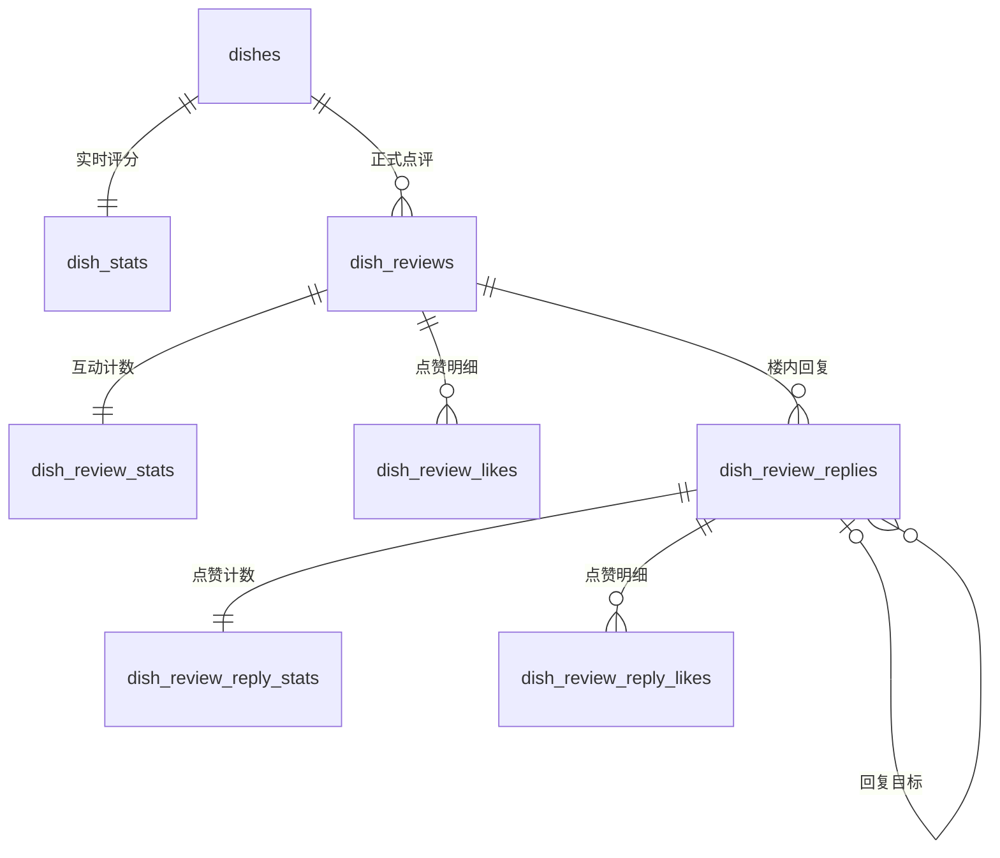

# 菜品点评、两级点赞与实时评分：V3 审查稿

日期：2026-10-20。基线：后端 dev f9b5d78 / 数据库 V14，Web develop 439d4a9，Android dev de351f2。

本稿保留V14基线的审查记录，已按后续开发指令拆分实现为Flyway V15（实时评分）、V16（点评点赞）、V17（回复）、V18（回复点赞）。当前字段与接口以[数据库设计](../database-design.md)和[互动契约](../api/dish/review-interactions.md)为准；[SQL草案](dish-review-interactions-v3.sql)不可与正式迁移叠加执行。

## 1. 范围与建议规则

1. 菜品正式点评继续带 1～5 分评分和文字，先审核后公开。沿用现有同用户同菜品最多一条正式点评规则，改成“最多一条未删除正式点评”。
2. 一级点评和楼内回复都能被点赞；同一用户可分别给多条点评或回复点赞，同一目标最多一个赞。点赞不经过内容审核。
3. 回复不带评分。支持直接回复一级点评，也支持回复同楼的另一条回复；页面保持两层展示。回复正文建议 1～500 字符，进入现有 AI/人工审核链。
4. 普通重新点评审核通过后更新同一条未删除点评，保留原 ID、点赞和讨论；不修改首次 created_at，updated_at 表示修改时间。此项保留互动的语义供本轮审查。
5. 主点评及回复采用软删除。主点评删除后整个讨论不可见，其评分立即从菜品汇总中扣除；删除后重新点评生成新 ID，互动重新计数。
6. 取消每日评分统计。正式点评新增、评分修改、删除在同一写事务内更新汇总；提交待审核、驳回、点赞和回复均不改变菜品评分。
7. 统计从事务提交后对后续新快照可见。已经开始的 REPEATABLE READ 事务仍可能看到旧快照；客户端响应本身也不会自动推送更新。

## 2. 结构总览

新增 6 张表，修改正式点评表和审核日志表，并扩展 AI 结论类型约束；保留原评论投稿审核表。这里的“新增统计表”是保存汇总值的普通表，不是物化视图。

| 对象 | 动作 | 职责 |
| --- | --- | --- |
| dish_review_submissions | 保留 | 主点评的投稿、审核及历史；既有字段与约束继续使用 |
| dish_reviews | 修改 | 正式点评；新增软删除，调整唯一约束和列表索引 |
| dish_stats | 新增 | 每个菜品的正式点评数、评分总和 |
| dish_review_stats | 新增 | 每条一级点评的点赞数、已通过回复数 |
| dish_review_likes | 新增 | 一级点评点赞明细 |
| dish_review_replies | 新增 | 楼内回复、审核、软删除 |
| dish_review_reply_stats | 新增 | 每条回复的点赞数 |
| dish_review_reply_likes | 新增 | 回复点赞明细 |
| content_moderation_logs | 修改 | 增加回复审核关联 |
| ai_moderation_results | 修改约束 | 允许 dish-review-reply 类型 |
| dish_rating_summary | 替换 | 由物化视图改为普通视图，读取 dish_stats 计算实时均分 |



## 3. 字段定义

以下表名均位于 foodtime schema。PK 表示主键，FK 表示外键；时间类型均使用 TIMESTAMPTZ。

### 3.1 dish_review_submissions：现有主点评投稿表，保留

| 字段 | 类型 | 空值 / 规则 |
| --- | --- | --- |
| id | UUID | PK |
| dish_id | UUID | 非空，FK dishes |
| user_id | UUID | 非空，FK users |
| rating | SMALLINT | 非空，1～5 |
| content | TEXT | 非空，正文由服务端验证非空白 |
| status | VARCHAR(20) | 非空，默认 pending；pending / approved / rejected |
| submitted_at | TIMESTAMPTZ | 非空，默认 now() |
| reviewed_by_user_id | UUID | 可空，FK users |
| reviewed_by_ai_model | TEXT | 可空，V11 已有字段 |
| reviewed_at | TIMESTAMPTZ | 可空，非 pending 时须有审核时间 |
| review_reason | TEXT | 可空 |
| updated_at | TIMESTAMPTZ | 非空，现有触发器维护 |

继续使用 pending 条件下 (dish_id,user_id) 唯一索引。历史投稿不计入菜品评论数或评分；不为本次方案新增投稿表。

### 3.2 dish_reviews：现有正式点评表，修改

| 字段 | 类型 | 空值 / 规则 |
| --- | --- | --- |
| id | UUID | PK；新点评由服务端生成 |
| dish_id | UUID | 非空，FK dishes；发布后不可改归属 |
| user_id | UUID | 非空，FK users；发布后不可改作者 |
| rating | SMALLINT | 非空，1～5 |
| content | TEXT | 非空；沿用现有主点评正文规则，本稿不增加长度上限 |
| submission_id | UUID | 可空，FK dish_review_submissions；V10 已有，用于溯源 |
| created_at | TIMESTAMPTZ | 非空；首次正式记录采用原投稿时间，后续编辑保留 |
| updated_at | TIMESTAMPTZ | 非空；现有触发器维护，点赞/回复不修改它 |
| deleted_at | TIMESTAMPTZ | **新增，可空**；非空表示删除 |

替换原 UNIQUE(dish_id,user_id) 为未删除条件下的部分唯一索引。新增按菜品和按作者的未删除列表索引，保持现有 created_at DESC,id ASC 排序。已删除记录禁止恢复和编辑；保留原有历史索引用于后台查询，不直接重复增加同名索引。

### 3.3 dish_stats：新增，菜品实时汇总

| 字段 | 类型 | 空值 / 规则 |
| --- | --- | --- |
| dish_id | UUID | PK，FK dishes；一菜品一行 |
| review_count | BIGINT | 非空，默认 0，非负；未删除正式点评数 |
| rating_sum | BIGINT | 非空，默认 0，非负；上述点评评分之和 |
| counter_version | BIGINT | 非空，默认 0，非负；评分汇总有效变化时递增 |
| updated_at | TIMESTAMPTZ | 非空，统计更新时间 |

额外约束：review_count <= rating_sum <= review_count*5；无点评时 count 和 sum 均为零。比较时转换成 NUMERIC，避免约束表达式中的整数乘法溢出。

均分不再单独累计或保存浮点值，兼容视图使用以下规则：

```sql
CASE WHEN review_count = 0 THEN NULL
     ELSE ROUND(rating_sum::NUMERIC / review_count, 2)
END
```

普通视图仅对每个统计行做除法，不聚合评论明细。输出 average_score 仍为 NUMERIC(3,2)，无点评返回 NULL，评论数为 0。

### 3.4 dish_review_stats：新增，一级点评互动汇总

| 字段 | 类型 | 空值 / 规则 |
| --- | --- | --- |
| review_id | UUID | PK，FK dish_reviews；一点评一行 |
| like_count | BIGINT | 非空，默认 0，非负；该点评点赞数 |
| reply_count | BIGINT | 非空，默认 0，非负；approved 且未删除的回复数 |
| counter_version | BIGINT | 非空，默认 0，非负；任一计数有效变化时递增 |
| updated_at | TIMESTAMPTZ | 非空，统计更新时间 |

reply_count 不包括主点评本身，不把“回复的点赞”累加到主点评点赞数。

### 3.5 dish_review_likes：新增，一级点评点赞明细

| 字段 | 类型 | 空值 / 规则 |
| --- | --- | --- |
| review_id | UUID | 非空，FK dish_reviews |
| user_id | UUID | 非空，FK users；取自服务端会话 |
| created_at | TIMESTAMPTZ | 非空，默认 now() |

PK(review_id,user_id)，不额外增加 id。点赞插入，取消删除；不允许 UPDATE。重复 INSERT ... ON CONFLICT DO NOTHING 不改变计数。

### 3.6 dish_review_replies：新增，楼内回复

| 字段 | 类型 | 空值 / 规则 |
| --- | --- | --- |
| id | UUID | PK，服务端生成 |
| review_id | UUID | 非空，FK dish_reviews，所属一级点评 |
| reply_to_id | UUID | 可空；空表示回复主点评，非空表示回复同楼另一条回复 |
| user_id | UUID | 非空，FK users，作者取自会话 |
| client_request_id | UUID | 非空；客户端为一次发布生成，重试复用 |
| content | TEXT | 非空；建议去首尾空白后 1～500 字符 |
| status | VARCHAR(20) | 非空，默认 pending；pending / approved / rejected |
| reviewed_by_user_id | UUID | 可空，人工审核人 FK |
| reviewed_by_ai_model | TEXT | 可空，AI 审核模型 |
| reviewed_at | TIMESTAMPTZ | 可空，最终状态必须填写 |
| review_reason | TEXT | 可空 |
| created_at | TIMESTAMPTZ | 非空，默认 now()，提交时间 |
| updated_at | TIMESTAMPTZ | 非空，复用现有更新时间触发器 |
| deleted_at | TIMESTAMPTZ | 可空，软删除 |

约束及建议规则：

- UNIQUE(review_id,id) 与复合 FK(review_id,reply_to_id) 保证回复目标同楼；禁止回复自身。
- 服务端仅允许引用已经存在、审核通过且未删除的目标。归属、作者、目标、正文、客户端操作 ID 与 created_at 提交后不可修改。客户端不能创建循环链；批量直接导入也必须检查循环。
- UNIQUE(user_id,client_request_id) 防重复发布；同操作 ID 重试返回原记录，若正文/目标与原操作不同则返回 409。它与每个 HTTP 请求的链路 requestId 是两种字段。
- pending 没有审核身份或审核时间；approved/rejected 必须有审核时间，并且人工审核人、AI 模型恰好填写一种。
- 最终审核状态不可重写；下架用软删除，已删除回复不可恢复或继续审核。回复正文暂不提供编辑，避免加入新版本审核状态。
- 不重复保存 dish_id、被回复用户 ID、昵称或头像；目标用户通过主点评或 reply_to_id 关联获得。
- 服务端 strip 并验证正文；数据库 btrim 长度约束用于兜底，不能替代服务端对全部空白字符的验证。

### 3.7 dish_review_reply_stats：新增，回复点赞汇总

| 字段 | 类型 | 空值 / 规则 |
| --- | --- | --- |
| reply_id | UUID | PK，FK dish_review_replies；一回复一行 |
| like_count | BIGINT | 非空，默认 0，非负 |
| counter_version | BIGINT | 非空，默认 0，非负；计数有效变化时递增 |
| updated_at | TIMESTAMPTZ | 非空，统计更新时间 |

回复点赞只更新这一行，不更新主点评统计或菜品统计。

### 3.8 dish_review_reply_likes：新增，回复点赞明细

| 字段 | 类型 | 空值 / 规则 |
| --- | --- | --- |
| reply_id | UUID | 非空，FK dish_review_replies |
| user_id | UUID | 非空，FK users，取自会话 |
| created_at | TIMESTAMPTZ | 非空，默认 now() |

PK(reply_id,user_id)。插入/删除语义与主点评点赞一致，禁止 UPDATE。

### 3.9 既有审核表的修改

| 对象 | 修改 |
| --- | --- |
| content_moderation_logs | 增加可空 UUID 字段 dish_review_reply_id，FK 指向回复；扩展“恰好一个审核关联”的约束；加非空部分索引 |
| ai_moderation_results | submission_type 允许 dish-review-reply，沿用已有 (submission_type,submission_id) 唯一约束，不新增其他字段 |

回复审核类型需要同步接入 AI 即审、定时补扫、人工队列、详情和日志响应；点赞不进入审核日志。删除原因继续由现有应用操作日志记录。

## 4. 索引与读取路径

| 表 / 条件 | 索引 | 用途 |
| --- | --- | --- |
| dish_stats | PK(dish_id) | 单菜品或菜品列表关联汇总 |
| dish_review_stats | PK(review_id) | 一页点评批量关联计数 |
| dish_review_reply_stats | PK(reply_id) | 一页回复批量关联赞数 |
| dish_review_likes | PK(review_id,user_id) | 去重、读取本人点赞状态 |
| dish_review_reply_likes | PK(reply_id,user_id) | 去重、读取本人点赞状态 |
| dish_reviews，未删除 | UNIQUE(dish_id,user_id) | 一用户一菜品一条有效点评 |
| dish_reviews，未删除 | (dish_id,created_at DESC,id ASC) | 主点评分页 |
| dish_reviews，未删除 | (user_id,created_at DESC,id ASC) | 本人点评分页 |
| replies，approved 且未删除 | (review_id,created_at ASC,id ASC) | 楼内回复游标分页 |
| replies，pending 且未删除 | (created_at ASC,id ASC) | 待审核队列 |
| replies，未删除 | (user_id,created_at DESC,id ASC) | 本人回复及审核状态 |
| replies，reply_to_id 非空 | (review_id,reply_to_id) | 回复目标关联和外键检查 |
| replies | UNIQUE(review_id,id) | 同楼外键 |
| replies | UNIQUE(user_id,client_request_id) | 重试去重 |

三张统计表只建立主键索引，计数、版本及 updated_at 不索引，初始 fillfactor=80；这样为 HOT 更新预留条件，但是否采用 HOT 由页空间等运行情况决定。暂不增加按点赞数排序、按用户列出全部点赞的索引，也不把大段正文 INCLUDE 到索引里。

读路径：

1. 菜品列表/评分接口读取 dish_stats 或普通 dish_rating_summary 视图，不执行评论 COUNT/AVG。原视图名和三列保留，便于现有列表查询平滑适配。
2. 点评列表先取一页主点评，再按 PK 关联 dish_review_stats 与会话用户的 dish_review_likes。分页 total 改用同一快照下 dish_stats.review_count，统计口径同为未删除正式点评。
3. 用户展开回复才读取该楼一页 approved、未删除回复，再按 PK 关联 reply_stats 和会话用户的 reply_likes。回复总数读主点评 stats.reply_count。
4. 回复升序使用 (created_at,id) > (:last_created_at,:last_id) 的游标，取 size+1 判断 hasMore。主点评暂保留 page/size 兼容；若新增游标，须匹配其时间降序、ID 升序的混合方向。
5. 公开返回 likeCount、likedByMe、replyCount、counterVersion；回复返回自己的 likeCount、likedByMe、counterVersion。计数版本只用于忽略旧计数响应，不能代替本人点赞操作的请求排序。
6. 纯 GET 用无行锁的可见性查询和一致性读取快照；现有读接口复用的 FOR SHARE 拆到写路径。分页、统计和可见性需要一致时使用同一 REPEATABLE READ 只读事务。

“我的点评”按作者的总数、管理员任意搜索 total 不等于单菜品计数，不能直接替换成 dish_stats.review_count。若以后这些查询成为热点，单独评估用户统计或游标分页。

## 5. 事务内实时更新规则

V3 选用数据库触发器作为计数更新的唯一入口，应用只操作业务明细/审核/软删除，不再手工执行 +1/-1。缺失统计行或计数下溢使整笔事务失败，不使用 GREATEST(0,...) 隐藏错误。

| 操作 | 菜品点评数 | 评分总和 | 点评点赞数 | 点评回复数 | 回复点赞数 |
| --- | --- | --- | --- | --- | --- |
| 首次主点评审核通过，新增正式记录 | +1 | +新评分 | 0 初始化 | 0 初始化 | 不变 |
| 同一未删除点评修改评分并通过 | 不变 | +新分−旧分 | 保留 | 保留 | 保留 |
| 正式点评只修改正文 | 不变 | 不变 | 保留 | 保留 | 保留 |
| 首次软删除主点评 | −1 | −旧评分 | 保留内部值 | 保留内部值 | 保留内部值 |
| 待审核投稿、驳回 | 不变 | 不变 | 不变 | 不变 | 不变 |
| 点评点赞实际插入 / 删除 | 不变 | 不变 | +1 / −1 | 不变 | 不变 |
| 回复 pending 变为 approved | 不变 | 不变 | 不变 | +1 | 不变 |
| 首次软删除 approved 回复 | 不变 | 不变 | 不变 | −1 | 保留内部值 |
| 待审核回复新增、驳回、删除 | 不变 | 不变 | 不变 | 不变 | 不变 |
| 回复点赞实际插入 / 删除 | 不变 | 不变 | 不变 | 不变 | +1 / −1 |
| 重复点赞、重复取消、重复删除 | 不变 | 不变 | 不变 | 不变 | 不变 |

点赞 INSERT 使用 ON CONFLICT DO NOTHING，取消使用 DELETE；只有实际变化的行触发计数。回复审核 UPDATE 带 status='pending' AND deleted_at IS NULL 条件；主点评和回复软删除 UPDATE 均带 deleted_at IS NULL，重复请求返回既有删除状态而不重写删除时间。回复幂等提交不得用 ON CONFLICT DO UPDATE 重写原正文或审核身份。

新菜品、新点评、新回复由触发器创建各自统计行。技术统计 FK 使用 ON DELETE CASCADE，避免空目录物理删除被统计行阻止；普通点评/回复入口仍必须软删除。点赞、回复和审核历史的业务外键使用 RESTRICT，不做大规模级联业务删除。

## 6. 可见性、并发与热点边界

- 服务端从会话取得用户 ID，继续使用 CSRF、权限和限流；客户端不能设置计数或审核字段。
- 新增点评点赞、回复、回复点赞及审核通过，都要求菜品、档口、食堂启用，主点评未删除。回复点赞还要求目标回复 approved 且未删除。
- 取消点赞、删除本人回复可清理不可见历史，仍须核验归属和目标存在。
- 所有写入口先按统一顺序锁目录上下文，再锁主点评，再锁需要的回复，最后由触发器更新统计。主点评仅校验用 FOR SHARE，修改用 FOR UPDATE；回复也是从一开始取得最终需要的锁模式。跨多条目标时按 ID 排序。
- 审核回复先普通查询其 review_id，再按规定顺序加锁，并在拿到锁后重新检查审核状态；避免先锁回复再锁主点评。SQL 草案的触发器负责计数，不替代应用层可见性、权限或锁顺序。
- 删除主点评只更新该行和菜品统计，公开隐藏整楼；不批量清空所有子回复和点赞。删除回复隐藏正文，后续回复保留，被回复摘要显示已删除。
- 只有已发布点评变化竞争该菜品 stats 行；主点评点赞只竞争该点评 stats 行；回复点赞只竞争该回复 stats 行。各层写入不会都集中到同一个菜品计数行。
- 一条极热门点评或回复的同时点赞仍会串行更新同一统计行；是否需要计数分片或短时缓存应按压测决定。本稿不引入异步计数延迟，也不承诺固定 QPS。

## 7. 取消每日评分任务与应用修改清单

| 位置 | 配套修改 |
| --- | --- |
| DishRatingSummaryRefresher | 移除该类/调度逻辑，删除启动刷新和每 24 小时 REFRESH |
| application.yml / 环境配置 / 配置文档 | 移除 app.rating-summary 的刷新开关、周期和延迟配置；历史部署变量清理 |
| dish_rating_summary | 删除物化视图，建立读取 dish_stats 的普通兼容视图，不再有刷新动作 |
| PublishedReviewMapper / Service | 分页 total 读 dish_stats；删除改软删除；读写可见性检查分离 |
| ModerationStore.publishReview | UPSERT 改为 ON CONFLICT(dish_id,user_id) WHERE deleted_at IS NULL；更新时只改 rating/content/submission_id，保留 created_at |
| 管理员评论删除、计数和查询 | 删除改软删除；明确历史查询条件；公开/个人活动记录过滤删除，后台历史统计不能误用活动计数 |
| 回复、回复点赞及主点评点赞 | 新增服务/接口；不手动更新计数，使用数据库触发器；客户端发布回复携带操作 UUID |
| AI 与人工审核 | 接入 dish-review-reply 的事件、补扫、队列、状态、日志；审核前检查主点评仍可见 |
| 测试与开发数据初始化 | 删除所有 REFRESH MATERIALIZED VIEW 调用，改为验证触发器统计；已有每日日快照测试重写为实时语义 |
| API 文档 / OpenAPI 注解 / Web / Android | 删除每日快照描述；增加两级点赞与回复入口、统计字段、操作状态及分页；评分旁文案改为实时统计 |

取消的是菜品评分统计任务。暂存图片每日清理属于文件维护，继续保留；AI 每五分钟补扫也继续保留，不改成评分任务。

## 8. 实施与审查要点

SQL 基于当前 V14，先在停写窗口锁定菜品和正式点评，按现有正式点评一次性 COUNT/SUM 回填，再安装事务触发器及新视图。以后普通业务请求不再统计评论明细；无每日评分任务。一次性迁移回填与故障诊断校验不属于被取消的周期任务。

建议审查以下业务选择：

- 同一用户一菜品一条未删除点评；重评保留原互动和首次创建时间。
- 回复正文 1～500 字符，支持回复楼内其他回复，自带审核，暂不提供编辑。
- 回复提交增加客户端操作 UUID 去重；点赞使用 PUT/DELETE 幂等操作。
- 删除主点评隐藏整楼；删除后新点评不复用旧讨论；统计保留内部历史值，不在公开接口暴露。
- 均分展示保留两位小数，无正式点评返回 NULL；回复和两类点赞都不参与评分。

本环境此前未发现可用 PostgreSQL 客户端或 Docker daemon，本轮不连接或修改实际数据库。草案完成静态核对，尚未执行 DDL、并发验证或压测。正式实施前应在隔离库验证：现有数据回填、同用户重评的评分差量、重复请求、并发点赞/取消、审核与删除竞态、事务回滚、跨楼回复、删除后重评、无点评均分、历史日志保留及热点行锁等待。

参考：[PostgreSQL 约束](https://www.postgresql.org/docs/current/ddl-constraints.html)、[HOT 更新](https://www.postgresql.org/docs/current/storage-hot.html)、[锁及死锁](https://www.postgresql.org/docs/current/explicit-locking.html)。
